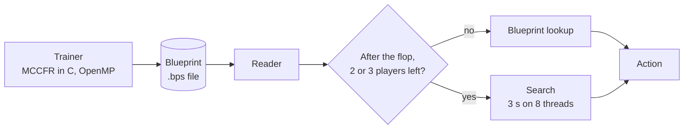

# NexusGTO

NexusGTO is an AI for six-player no-limit Texas hold'em. It follows the design of Pluribus, the
program that beat elite professionals at the same game in 2019. It plays a blueprint strategy
trained by Monte Carlo counterfactual regret minimization (MCCFR) over 8.05 billion iterations of
self-play. After the flop, when two or three players are left, it searches instead: a 3-second
re-solve on 8 threads from the start of the betting round.

This repository holds the trainer, the blueprint reader, the search, the evaluation harness and
every published result, with a script that recomputes each one from the per-deal data. The
write-up is at [nexusgto.com](https://nexusgto.com).

## Results

In six-player matches against five copies of its own blueprint, the search won
**+5.73 bb/100 over 14,250 deals (95% interval 2.74 to 8.72)**. The blueprint scores exactly
zero against copies of itself, so the search plays better than the strategy it starts from, at
least against these opponents. Stacks are 100 big blinds and there is no rake. Every deal is
played six times, once with the tested player in each seat, and scored with AIVAT, which
subtracts the luck it can calculate.

A local best responder, a program built to exploit a fixed strategy, played the same 2,000 deals
against each version, heads-up in the blinds.

| Version | Won against five blueprint copies, 14,250 deals | Best responder won from it, 2,000 deals |
|---|---|---|
| Blueprint alone | 0 by construction | 114.8 (95% interval 73.5 to 156.0) |
| Search without own-range tracking | +8.61 (95% interval 5.24 to 11.98) | 64.4 ± 17.6 |
| Search with own-range tracking | **+5.73 (95% interval 2.74 to 8.72)** | 9.2 ± 18.6 |

All figures are bb/100, and ± is one standard error. In the last column lower is better.

- From the blueprint alone the best responder won 114.8 bb/100, more than the 75 bb/100 a
  player who folded every hand would lose, though the 95% interval (73.5 to 156.0) reaches
  just below that.
- Against the search with own-range tracking, its winnings are too close to zero to tell apart
  from luck. That version tracks the range its own actions reveal; the other assumes it played
  the blueprint, which leaves its real range open to exploitation.
- The tracking changed the win rate against the blueprint field by −2.88 bb/100 (95% interval
  −6.05 to +0.30, so it may be noise) and cut the best responder's winnings from 64.4 to 9.2.
- The best-responder figures value each showdown over every hand the version could hold. In
  chips actually won, the tracked search gave up 31.7 ± 24.1.
- In the headline run, 2.36% of the 38,451 searches fell back to the blueprint.

[`results/`](results/README.md) lists every published number with its data and conditions.

## Limits

- **Fixed bet menu.** Before the flop the blueprint raises 0.7 or 1.0 times the pot at the first
  two raise levels and 1.0 at the third, with at most three raises. After the flop a first bet is
  0.75 pot and every later raise is pot. There is no separate all-in action. An opponent's bet
  off the menu is mapped to one of the two nearest menu sizes for blueprint lookups
  (pseudo-harmonic mapping) and added to the search tree.
- **Search with two or three players only.** Before the flop, and after it with four or more
  players left, NexusGTO plays the blueprint.
- **Tested against its own blueprint.** The opponents were copies of the blueprint and two
  scripted deviations from it, one tight and one loose. It has not played people or other
  programs. The best responder looks one step ahead and bets only NexusGTO's own sizes, so a
  stronger exploiter could win more. Every test used the six-player game with 100-big-blind
  stacks and no rake.
- **The published search runs can't be replayed bit for bit.** They used 8 threads and a 3-second
  deadline, so the iterations a solve reaches depend on timing. The golden tests pin the search
  with one thread and a fixed iteration count instead.
- **The digests hold for gcc 13.3 on x86-64 Linux.** The golden digests and the fixture
  blueprint's bytes depend on float rounding, which another compiler or libm can change.
- **The 8.05B blueprint is not in this repository.** It is a 12.2 GB file. Without it the code runs
  on the small test blueprint in `tests/fixtures/`, which is far from converged. The published
  results can still be checked from their per-deal data. The trainer is here, but a full run
  takes days on a many-core server.

## Known issues

- **The search tree allows fewer raises than the blueprint.** Of the 907 searches that fell
  back to the blueprint in the headline run, 311 faced a legal raise the tree lacked and 52
  came after its two-raise cap.
- **Off-menu bets are not measured.** No opponent in the published matches bet off the menu,
  so the results do not test how NexusGTO handles such bets.
- **The vector sampler is biased with three or more players.** By default it reserves a hand
  for the searcher that opponents can then never hold. The opt-in `-DES_VEC_OPP_SAMPLER` build
  is not validated. The published three-player searches used the default, so their numbers
  stand as measured.
- **Some file reads are unchecked.** The blueprint reader and the checkpoint loader do not
  check every `fread`. The published inputs are hash-checked, so the results are unaffected.
  `make all` prints compiler warnings, and the search library is built with `-w`.

## Quickstart

NexusGTO needs x86-64 Linux, gcc with OpenMP, make and Python 3.9 or later. It is tested with
gcc 13.3 and Python 3.12 on Ubuntu 24.04.

Install it into a virtual environment. The package installs top-level modules with generic
names (`app`, `scripts`, `engine`, `es_resolver`) that can clash with other packages.

```sh
sudo apt install build-essential python3-venv   # Ubuntu
git clone https://github.com/ZHANGV25/nexusgto nexusgto
cd nexusgto
python3 -m venv .venv
. .venv/bin/activate
python -m pip install -e ".[test]"
make all     # builds the native libraries into solver/build
make check   # C tests, then the Python tests, including the fixture goldens
```

`make check` takes a few minutes. The goldens in `tests/goldens/` replay fixed-seed matches,
one with the search, and compare every blueprint lookup, search decision and solve with the
recorded digest. Each file holds the match command it replays.

### Reproduce the results

The per-deal data is the release asset `nexusgto-results.tar` (49.3 MB) of this repository's
v1.0.0 release. Download it into the repository root, then:

```sh
sha256sum nexusgto-results.tar
# defc6f237298f57c5e5edd4969645e169153c89e6cdef21d4239a67d2f13e449
mkdir -p results/data
tar -xf nexusgto-results.tar -C results/data
python results/reproduce.py
```

`reproduce.py` uses only the standard library and takes about 10 seconds. It recomputes every
row of `results/numbers.yaml` that has data and checks it at the precision it was published.
The first lines are the headline:

```
Headline: Every-street search with own-range tracking vs the blueprint field
  14,250 deals, +5.73 ± 1.53 bb/100 (95% CI 2.74 to 8.72)  [matches numbers.yaml]
```

## How it works



- **Trainer** (`solver/src/blueprint/`, run by `solver/precompute/blueprint_worker_unified.py`).
  External-sampling MCCFR over the six-player game, with linear discounting and regret-based
  pruning on Pluribus's schedule. The threads share one lock-free table of information sets.
  Hands are grouped into buckets that share a strategy: 169 preflop classes and 200 buckets on
  each later street.
- **Blueprint file and reader** (`solver/src/blueprint/bps_reader.c`,
  `solver/python/engine/bps_reader_py.py`). The format is in
  [`docs/bps-format.md`](docs/bps-format.md).
- **Search** (`solver/src/search/`, set up by `api/app/engine/cpu_es_solver.py`). External-sampling
  MCCFR on the CPU, re-solving from the start of the current betting round. Each opponent's
  range comes from the blueprint and the actions that opponent took. With own-range tracking,
  the searcher's own range comes from the strategies its earlier searches played. Where the tree
  stops, sampled rollouts value the leaves; heads-up flop searches run through the river.
- **Hand evaluator** (`solver/src/core/hand_eval.h`, with the table in
  `solver/src/core/hand_eval_table.c`). A lookup table over all 2,598,960 five-card hands.
- **Game model** (`api/app/engine/agent/`). The rules, the bet menu and the information-set keys,
  matched to the trainer's and checked against it in tests.
- **Evaluation** (`api/scripts/`). Duplicate matches with AIVAT (`run_match.py`,
  `match_aivat.py`), the local best responder (`lbr_*.py`) and the decision audit
  (`decision_audit.py`).

## Files to read first

| File | What to look at |
|---|---|
| `solver/src/blueprint/mccfr_blueprint.c` | `traverse`, one MCCFR iteration; `info_table_find_or_create`, the table the threads share |
| `solver/src/search/es_resolver.c` | `es_run`, `es_traverse` and `es_traverse_vec`, the search's iterations |
| `solver/src/core/hand_eval.h` | The hand evaluator; its lookup table is built in `hand_eval_table.c` |
| `api/app/engine/cpu_es_solver.py` | How a game state becomes a search and how its strategy is read out |
| `api/app/engine/agent/strategy_source.py` | `LiveResolveSource`, which decides between search and blueprint |
| `api/scripts/run_match.py` | `play_deal_group` and `run_match`, the duplicate-match harness |
| `results/reproduce.py` | How each published number is recomputed |

## Data

| Path | Contents |
|---|---|
| `data/abstraction/` | The card abstraction files the trainer and the reader need |
| `data/training/` | The manifests the 8.05B training run wrote at each checkpoint |
| `results/` | `numbers.yaml`, `reproduce.py` and the list of every search configuration measured; the per-deal data is the release asset |
| `tests/fixtures/` | A tiny blueprint of the same game, for tests |
| `tests/goldens/` | Fixed-seed match digests |

The code is under the Apache License 2.0 ([`LICENSE`](LICENSE)). The contents of `results/` and
`data/`, and the release asset, are under CC BY 4.0 ([`LICENSE-DATA`](LICENSE-DATA)).

## Links

- Write-up: [nexusgto.com](https://nexusgto.com)
- Pluribus: Noam Brown and Tuomas Sandholm, Science, 2019
  ([doi:10.1126/science.aay2400](https://doi.org/10.1126/science.aay2400))
- Local best response: Viliam Lisý and Michael Bowling, AAAI Workshop on Computer Poker and
  Imperfect Information Games, 2017 ([arXiv](https://arxiv.org/abs/1612.07547))
- AIVAT: Neil Burch, Martin Schmid, Matej Moravčík, Dustin Morrill and Michael Bowling, AAAI, 2018
